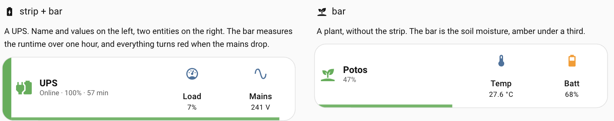
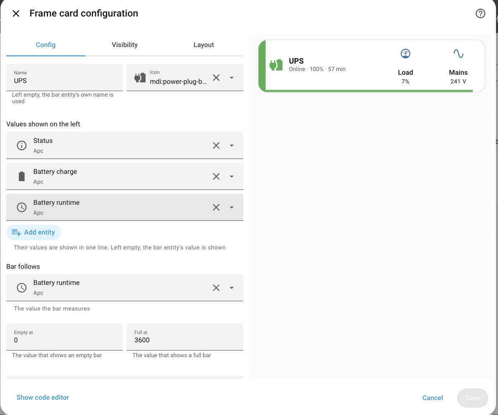
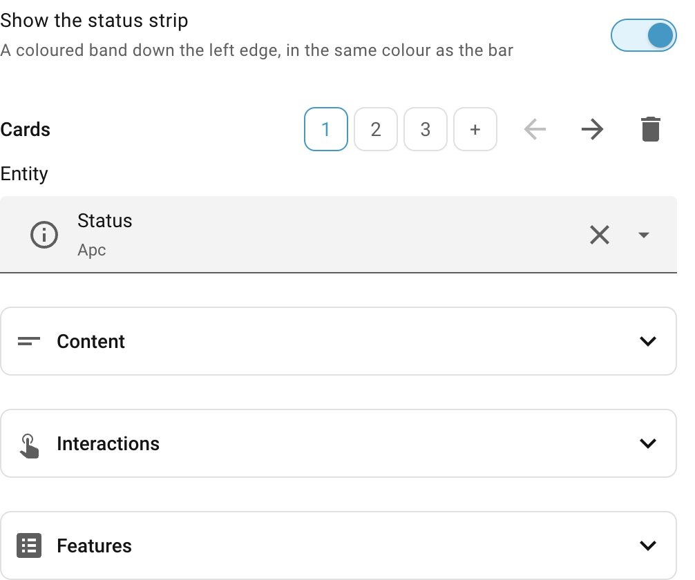
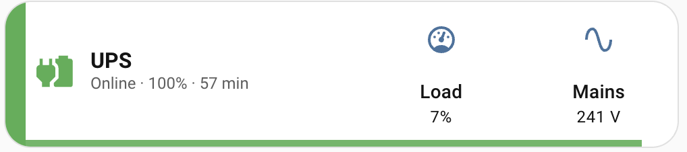
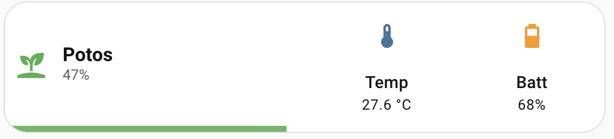

# Frame Card

[![hacs][hacs-badge]][hacs-url]
[![release][release-badge]][release-url]
[![license][license-badge]](LICENSE)

A Home Assistant card with **a name and a line of values on the left, your cards on the right**,
all inside one frame — and a **fill bar** along the bottom, plus an optional coloured **status
strip** down the left edge. The bar follows an entity and turns amber or red on thresholds you
set, or the moment an alert state comes on.

Everything is configured in the visual editor. There are no templates to write and no CSS.



No dependencies, no build step, ~20 KB.

## Installation

### HACS

[](https://my.home-assistant.io/redirect/hacs_repository/?owner=sleepyraptor&repository=homeassistant-frame-card&category=plugin)

That button opens the repository straight in your own Home Assistant. By hand:

1. HACS → three-dot menu → **Custom repositories**.
2. Add `https://github.com/sleepyraptor/homeassistant-frame-card`, category **Dashboard**.
3. Install **Frame Card**, then hard-refresh the browser (`Ctrl/Cmd + Shift + R`).

### Manual

1. Download `frame-card.js` from the [latest release][release-url].
2. Copy it into `config/www/`.
3. **Settings → Dashboards → ⋮ → Resources** → add `/local/frame-card.js`, type
   **JavaScript module**.
4. Hard-refresh the browser.

## Setting it up

Add **Frame** from the card picker and fill in the form. Everything is a picker, a number or a
switch — the name is the only thing typed:



**Values shown on the left** is a plain entity list — add as many as you want and their values
are joined into one line. A duration in seconds is shown in minutes, a percentage tightly, the
rest as it comes: `Online · 100% · 57 min`.

Picking the bar entity fills in what a full bar means for its unit — seconds become one hour, a
percentage stays 0-100 — so the two range fields are usually already right.

Further down, the **Cards** row is the list of cards on the right: pick one by its number to edit
it, move it with the arrows, remove it with the bin, add one with **+**. Each is edited with Home
Assistant's own editor for that type.



## Options

| Option | Type | Default | Description |
|---|---|---|---|
| `type` | string | — | `custom:frame-card` |
| `cards` | list | **required** | The cards on the right, side by side. |
| `entity` | entity | **required** | The value the bar measures. |
| `name` | string | — | The title on the left. Omitted, the bar entity's own name is used. |
| `icon` | icon | — | The icon on the left. Omitted, the bar entity's own icon is used. |
| `info` | list | — | Entities whose values make the line under the name. Omitted, the bar entity's value is shown. Omit `name` and `info` both and the left half disappears. |
| `min` | number | `0` | The value that shows an empty bar. |
| `max` | number | `100` | The value that shows a full bar. |
| `color` | colour | `green` | The bar's colour while everything is fine. |
| `warn_below` | number | — | Turn amber below this share of the bar, in percent. Omit and it never turns amber. |
| `danger_below` | number | — | Turn red below this share. Omit and it never turns red. |
| `alert_entity` | entity | — | Turn red while this entity is in `alert_state`, whatever the level. |
| `alert_state` | string | — | The state that counts as an alert, e.g. `On Battery`. |
| `strip` | bool | `false` | Draw the coloured band down the left edge. |

**Deliberately absent:** spacing, corner radius, layout, per-card widths. The frame is a frame:
the left half holds the name and the values, the right half is your cards, sharing it evenly.

## Examples

You never have to write this — it is what the editor produces.

### A UPS: strip and bar

The bar is the runtime over one hour. It goes amber under half an hour, red under twelve
minutes, and red immediately if the mains drop, whatever the battery says.



```yaml
type: custom:frame-card
name: UPS
icon: mdi:power-plug-battery
info:
  - sensor.ups_status
  - sensor.ups_battery_charge
  - sensor.ups_battery_runtime
entity: sensor.ups_battery_runtime
min: 0
max: 3600
color: green
warn_below: 50
danger_below: 20
alert_entity: sensor.ups_status
alert_state: On Battery
strip: true
cards:
  - type: tile
    entity: sensor.ups_load
    name: Load
    vertical: true
  - type: tile
    entity: sensor.ups_input_voltage
    name: Mains
    vertical: true
```

### A plant: bar only



```yaml
type: custom:frame-card
name: Potos
icon: mdi:sprout
entity: sensor.plant_soil_moisture
color: green
warn_below: 30
cards:
  - type: tile
    entity: sensor.plant_temperature
    name: Temp
    vertical: true
  - type: tile
    entity: sensor.plant_battery
    name: Batt
    vertical: true
```

## Notes

- **Tapping the left half opens the bar entity's more-info dialog.**
- **The children lose their own frame.** Their background, border and shadow are turned off so
  the frame is the only card drawn. Their content is untouched.
- **The strip and the bar reserve their own space**, so nothing is ever drawn underneath them.
- **An unavailable entity empties the bar** instead of breaking the card.
- **Thresholds are a share of the bar, not of the entity.** `warn_below: 50` on a 0-3600 bar
  means half an hour, not fifty seconds.
- **The type list when adding a card is this card's, not Home Assistant's.** Its own picker lives
  in a dialog that is not loaded until you open it, so the list here is the built-in types plus
  every custom card installed, and it accepts anything else typed in.

## Development

```bash
npm install
npm test          # node --test, DOM under happy-dom
```

[hacs-badge]: https://img.shields.io/badge/HACS-Custom-41BDF5.svg
[hacs-url]: https://github.com/hacs/integration
[release-badge]: https://img.shields.io/github/v/release/sleepyraptor/homeassistant-frame-card
[release-url]: https://github.com/sleepyraptor/homeassistant-frame-card/releases/latest
[license-badge]: https://img.shields.io/badge/license-MIT-blue.svg
